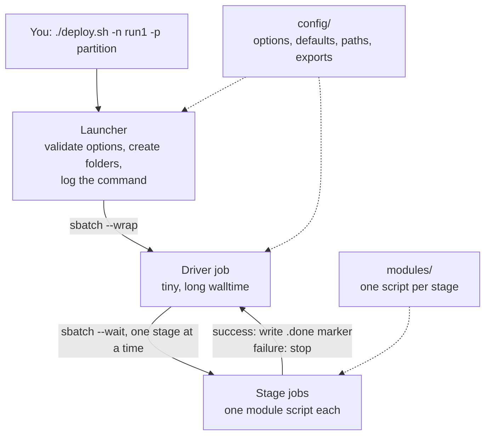

# Designing a Slurm pipeline: guiding principles

A short guide for building a bioinformatics (or any batch-analysis) pipeline on a Slurm cluster in plain bash. It sets out the principles that make a pipeline easy to run, resume, debug and hand on, with the reasoning behind each and the smallest piece of code that applies it.

It is distilled from a working pipeline, [`metagenomic_slurm`](https://github.com/Peter-Kille/metagenomic_slurm), which is the worked example. Its [PIPELINE_GUIDE.md](https://github.com/Peter-Kille/metagenomic_slurm/blob/main/PIPELINE_GUIDE.md) walks through the real code line by line.

**Who this is for:** someone who can write bash and has submitted Slurm jobs, and now wants to chain many steps over many samples reliably. No workflow manager is needed; you can move to Snakemake or Nextflow later with the same design thinking.

**Contents**

1. [The pattern at a glance](#the-pattern-at-a-glance)
2. [The principles](#the-principles)
3. [Designing a new pipeline: questions to answer first](#designing-a-new-pipeline-questions-to-answer-first)
4. [Building it: a suggested order](#building-it-a-suggested-order)
5. [Starter skeleton](#starter-skeleton)
6. [Anti-patterns](#anti-patterns)
7. [Pre-release checklist](#pre-release-checklist)

---

## The pattern at a glance

Three layers, one launcher, one small long-lived job that drives the rest.



| Layer | Responsibility | Knows nothing about |
|---|---|---|
| `config/` | Options, defaults, validation, directory paths, exports | What the stages do |
| `modules/` | One analysis step each, with its own resource request | Other stages, ordering, options parsing |
| `deploy.sh` | Order, dependencies, parallelism, failure handling | How any tool is run |

Keeping these apart is the single most useful habit: you can change a tool's command without touching the orchestration, and reorder stages without touching a tool.

## The principles

### 1. Separate configuration, work and orchestration

**Why:** mixing them makes every change risky and every script unreadable.
**How:** options and paths in `config/`, one stage per script in `modules/`, ordering only in `deploy.sh`. A module should be runnable on its own given the exported variables.

### 2. Validate on the login node, before submitting anything

**Why:** an error found at submission costs seconds; the same error three hours into a run costs a queue wait and a lot of compute.
**How:** check required options, allowed values and numeric ranges in your config. Keep an allow-list of partitions. Check that required software modules exist and that input files are present.

```bash
[[ -z "$NAME" ]] && { echo "Error: --name is required" >&2; exit 1; }
validate_partition "$PART" || { echo "Error: invalid partition '$PART'" >&2; exit 1; }
```

### 3. One source of truth for settings and paths

**Why:** a path typed in two scripts will eventually differ in one of them.
**How:** set every default once, build every directory once (`config/folders`), `export` them, and use the variables everywhere. Never hard-code a path in a module.

### 4. Be explicit about the environment

**Why:** a job runs in a fresh process on another node. It sees only what was **exported** and what it loads itself.
**How:**

- `export` every variable a module uses.
- `module load` inside each module, not in the launcher.
- Remember `sbatch` inherits the submitter's environment (`--export=ALL`), including `SLURM_MEM_PER_*`; clear those in any job that submits others.
- A module cannot hand variables back; pass results through files.

### 5. Make every stage restartable

**Why:** long pipelines fail halfway. Re-doing everything wastes days.
**How:**

- **Done markers.** The driver writes `.done_STAGE` only after Slurm reports success; a rerun skips stages that have one.
- **Clean before you write.** Delete a stage's partial outputs at its start (`rm -f`), because some tools refuse to overwrite and others append.
- **Write atomically.** Write to a temporary name and `mv` into place at the end, so a half-written file is never mistaken for a result.
- **Invalidate on change.** If you change a stage's code or inputs, delete its marker and the markers after it.

### 6. Let the driver enforce order, not the queue

**Why:** submitting every stage upfront with dependencies (`afterok`, `singleton`) puts the entire pipeline in the queue at once. That hits submit limits, hides failures in pending jobs, and makes resuming awkward.
**How:** a small *driver* job runs the stage list and uses `sbatch --wait` to block on each stage. Only the current stage is queued.

```bash
sbatch --wait "$@" && touch "$marker" || exit 1
```

`--wait` exits non-zero if the job, or any task of an array, fails.

### 7. Parallelise deliberately

**Why:** independent work should overlap, but unthrottled parallelism overloads storage and the scheduler.
**How:**

- **Across samples:** Slurm arrays (`--array=1-N%K`); each task selects its sample from `SLURM_ARRAY_TASK_ID`. Choose `K` from the stage's weight: high for light steps, low for memory-heavy ones.
- **Across independent stages:** background subshells and `wait`, with an explicit gate before anything that needs all of them.
- **Never** install software or write shared files from inside an array task; all tasks run at once. Do it in a separate single-job stage first.

### 8. Declare resources with the code that needs them

**Why:** guessed or copied resource requests waste queue time or kill jobs.
**How:** put `#SBATCH` lines at the top of each module. Pass `${SLURM_CPUS_PER_TASK}` to the tool's thread option so the two cannot disagree. Set `--time` for long steps. After a first run, use `sacct` (`MaxRSS`, `Elapsed`) or `seff` to right-size.

### 9. Record provenance

**Why:** in six months you need to know exactly what produced a result.
**How:**

- Append the full command line (captured with `printf '%q '`) to a log file in the run directory.
- Have each module print its own script (`cat $0`) and key environment values at the top of its log.
- Record tool and database versions in the logs, and name database folders by version.

### 10. Treat reference data as shared and read-only

**Why:** copying 100 GB databases per run wastes space and time, and writable shared data gets corrupted.
**How:** keep one library of versioned databases. Link into the run directory instead of copying (`ln -sfn`); download only if the library lacks the version. Keep the library read-only for everyone but the curator.

### 11. Fail loudly, early, and with a pointer

**Why:** silent failures produce wrong results that look right.
**How:** stop on the first failed stage and print which one and where its logs are. Check that expected outputs exist and are non-empty at the end of a stage. Prefer an explicit warning over a missing file discovered later.

### 12. Make it testable without the cluster

**Why:** debugging by waiting in the queue is slow.
**How:**

- `bash -n script.sh` finds syntax errors; ShellCheck finds subtler ones.
- Run the driver logic with a fake `sbatch` function to test skip, success, failure and resume.
- Offer a foreground mode (`-F`) and keep a tiny test dataset to exercise every stage quickly.

### 13. Document the interface, not the internals

**Why:** users need the options, outputs and recovery steps, not your bash.
**How:** a `-h` help that matches the README, a worked example command, a table of outputs, and a "what to do when it fails" section.

## Designing a new pipeline: questions to answer first

Answer these before writing code; each maps to a principle.

| Question | Decides |
|---|---|
| What are the stages, and which depend on which? | Order, what can run in parallel, where the gates are |
| Which stages are per-sample (arrays) and which are single jobs? | Array vs single submission, `%K` throttles |
| What does each stage need (CPU, memory, time)? | `#SBATCH` header per module, partition choice |
| Which inputs and databases are large or shared? | Library layout, link-vs-download logic |
| What can a user reasonably change? | The options list and defaults |
| What must be validated up front? | Allow-lists, ranges, file existence |
| What happens if stage N fails? | Markers, cleanup at stage start, resume behaviour |
| How many jobs does the cluster allow in the queue? | Driver pattern, array sizes, chunking |
| What proves the run is correct? | End-of-stage checks, summary tables, test data |

## Building it: a suggested order

1. **Sketch the stage graph** on paper: boxes, arrows, which are arrays, which run together.
2. **Write the config first.** Options with defaults, validation, folder creation, exports. Test it by itself: `source config/arguments; env | grep mything`.
3. **Write one module and run it by hand** (`sbatch modules/1-x.sh`) with the config sourced, until it works on a single sample.
4. **Write `deploy.sh` with just `run` and one stage.** Confirm skip, success and failure behave, using a fake `sbatch` first.
5. **Add stages one at a time**, testing each with the markers in place so earlier stages are skipped.
6. **Add the driver hand-over** once the foreground mode works end to end.
7. **Add parallel branches and gates** last, when the sequential version is solid.
8. **Run a small real dataset**, then check logs with `sacct` and tune resources.
9. **Write the README** from the user's side: install, run, options, outputs, recovery.

## Starter skeleton

The smallest version of the pattern: options, folders, the driver hand-over, `run`, one single job and one array job.

```text
my_pipeline/
├── deploy.sh
├── config/
│   ├── arguments
│   └── folders
└── modules/
    ├── 1-prepare.sh
    └── 2-analyse_array.sh
```

**`config/arguments`**

```bash
#!/bin/bash
CMDLINE="$(printf '%q ' "$0" "$@")"; export CMDLINE     # before getopt changes "$@"

NAME=""; PART=""
workdir="$(pwd)/work"
driver_part="epyc_long"; driver_time="7-00:00:00"; foreground="no"
VALID_PART=("epyc" "epyc_long")

PARSED=$(getopt -o n:p:w:Fh --long name:,partition:,work:,foreground,help -- "$@") || exit 1
eval set -- "$PARSED"
while true; do
  case "$1" in
    -n|--name)       NAME="$2"; shift 2 ;;
    -p|--partition)  PART="$2"; shift 2 ;;
    -w|--work)       workdir="$2"; shift 2 ;;
    -F|--foreground) foreground="yes"; shift ;;
    --) shift; break ;;
  esac
done

[[ -z "$NAME" ]] && { echo "Error: --name is required" >&2; exit 1; }
[[ -z "$PART" ]] && { echo "Error: --partition is required" >&2; exit 1; }
printf '%s\n' "${VALID_PART[@]}" | grep -qx -- "$PART" || { echo "Error: invalid partition '$PART'" >&2; exit 1; }

export NAME PART workdir driver_part driver_time foreground
```

**`config/folders`**

```bash
#!/bin/bash
pipedir=$(pwd -P)
moduledir="${pipedir}/modules"
rawdir="${pipedir}/raw_data"
outdir="${pipedir}/outdir"
log="${workdir}/0-log"
mkdir -p "${workdir}" "${rawdir}" "${outdir}" "${log}"

if [[ -z "${PIPELINE_DRIVER}" ]]; then {
    echo "# $(date '+%F %T') user=${USER} host=$(hostname)"
    echo "${CMDLINE}"; echo ""
} >> "${log}/0_execution_commandline.txt"; fi

export pipedir moduledir rawdir outdir log
```

**`deploy.sh`**

```bash
#!/bin/bash
source config/arguments
source config/folders

# ---- hand over to a driver job ----
if [[ -z "${PIPELINE_DRIVER}" && "${foreground}" != "yes" ]]; then
    driver_id=$(sbatch --parsable --job-name="${NAME}_driver" --partition=${driver_part} \
        --time="${driver_time}" --cpus-per-task=1 --mem=1G \
        --output="${log}/0_driver_%J.out" --error="${log}/0_driver_%J.err" \
        --export=ALL,PIPELINE_DRIVER=1 \
        --wrap "cd '$(pwd -P)' && bash ${CMDLINE}")
    echo "Driver job submitted: ${driver_id}"
    exit 0
fi
unset SLURM_MEM_PER_NODE SLURM_MEM_PER_CPU SLURM_MEM_PER_GPU

# run STEP_NAME <sbatch options...> <module script>
run() {
    step_name="$1"; shift
    marker="${workdir}/.done_${step_name}"
    if [ -e "$marker" ]; then echo "SKIP   ${step_name}"; return 0; fi
    echo "SUBMIT ${step_name}"
    sbatch --wait "$@"
    if [ $? -eq 0 ]; then touch "$marker"; echo "DONE   ${step_name}"
    else echo "FAILED ${step_name} - see ${log}/" >&2; exit 1; fi
}

# ---- stages ----
run 1-prepare --job-name=${NAME} --partition=${PART} \
    --output="${log}/1-prepare_%J.out" --error="${log}/1-prepare_%J.err" \
    "${moduledir}/1-prepare.sh"

sample_number=$(find "${rawdir}" -maxdepth 1 -name "*_1.fastq.gz" | wc -l)
[[ "$sample_number" -eq 0 ]] && { echo "No input files in ${rawdir}" >&2; exit 1; }

run 2-analyse --array="1-${sample_number}%20" --job-name=${NAME} --partition=${PART} \
    --output="${log}/2-analyse_%J.out" --error="${log}/2-analyse_%J.err" \
    "${moduledir}/2-analyse_array.sh"
```

**`modules/2-analyse_array.sh`**

```bash
#!/bin/bash
#SBATCH --nodes=1
#SBATCH --cpus-per-task=8
#SBATCH --mem=32000
#SBATCH --time=04:00:00

cat $0
file=$(ls "${rawdir}"/*_1.fastq.gz | sed -n ${SLURM_ARRAY_TASK_ID}p)
base=$(basename "$file" _1.fastq.gz)

rm -f "${outdir}/${base}.result.txt"                       # clean before writing
mytool --threads ${SLURM_CPUS_PER_TASK} -i "$file" -o "${outdir}/${base}.result.tmp" \
    && mv "${outdir}/${base}.result.tmp" "${outdir}/${base}.result.txt"   # atomic finish
```

Parallel branches follow the same style:

```bash
pids=()
( run 2A ...; run 2B ... ) &  pids+=($!)
run 3A ... &                  pids+=($!)
failed=0; for p in "${pids[@]}"; do wait "$p" || failed=1; done
[[ $failed -ne 0 ]] && exit 1
```

## Anti-patterns

| Anti-pattern | Why it hurts | Instead |
|---|---|---|
| Submitting every stage upfront with dependencies | Fills the queue, hits submit limits, hard to resume | Driver job with `sbatch --wait` |
| Running the pipeline from a login-node shell or `nohup` | Dies when the session or node does | Driver as a Slurm job (or `tmux` with `-F`) |
| Hard-coded paths in modules | Breaks on the next machine or run | Exported variables from `config/folders` |
| Forgetting `export` | Module sees an empty variable | Export everything a module reads |
| Installing or downloading inside an array task | Tasks collide and corrupt files | A separate single-job stage first |
| No cleanup at stage start | Reruns fail or append duplicates | `rm -f` the stage's outputs first |
| Partial outputs left in place | A rerun treats them as results | Write to a temp name, `mv` when done |
| Resources copied from another script | Over- or under-sized jobs | Measure with `sacct`/`seff`, then set |
| Silent skips and missing-file warnings | Wrong results that look right | Check outputs; fail with a clear message |
| Windows line endings in `.sh` files | `do\r` syntax errors, corrupt URLs | LF endings; `.gitattributes` with `*.sh text eol=lf` |
| Copying large databases per run | Wastes space and time | Shared read-only library plus symlinks |

## Pre-release checklist

- [ ] `bash -n` passes on every script; ShellCheck reviewed.
- [ ] Options validated on the login node; `-h` matches the README.
- [ ] Every variable a module uses is exported.
- [ ] Every module has `#SBATCH` resources and sensible `--time`.
- [ ] Each stage cleans old outputs and finishes atomically or checks its outputs.
- [ ] Resume tested: kill or fail a middle stage, rerun, confirm earlier stages skip.
- [ ] Failure tested: a failing stage stops the pipeline with a clear message.
- [ ] Largest realistic sample count fits within `MaxSubmitJobs`.
- [ ] Command line, tool versions and database versions are logged.
- [ ] A small test dataset and the expected outputs are documented.
- [ ] README covers install, run, options, outputs, resume and cancel.
